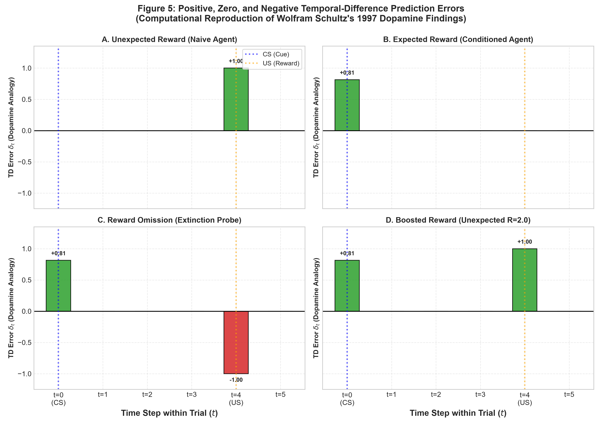
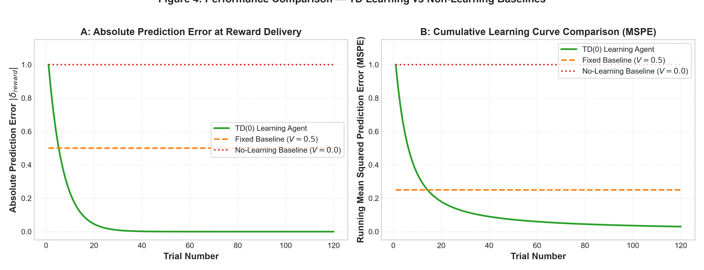
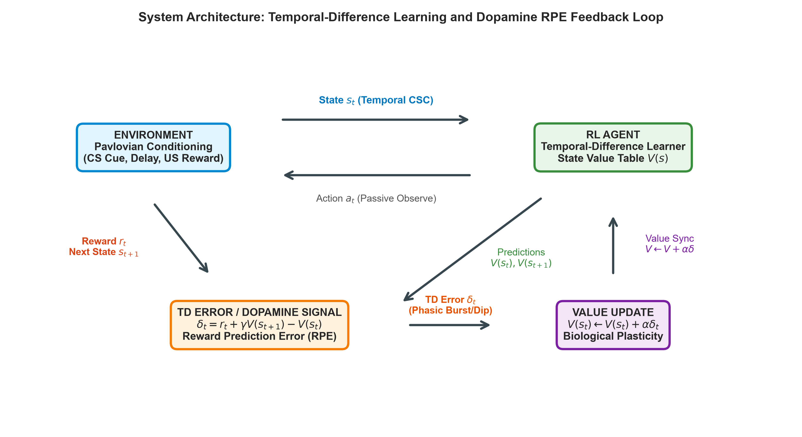

# 🧠 Project 22: Dopamine and Temporal-Difference Learning ✨
### *A Computational Simulation of Reward Prediction Error (RPE) & Dopaminergic Dynamics* 🐾

[](https://www.python.org/)
[](LICENSE)
[-orange.svg?logo=openai&logoColor=white)](https://en.wikipedia.org/wiki/Temporal_difference_learning)
[-purple.svg)](https://www.science.org/doi/10.1126/science.275.5306.1593)

---

## 👥 Project Team & Contributors

| 🎓 Student Name | 🆔 Roll Number | 💻 Role & Contribution |
| :--- | :---: | :--- |
| **Shaik Juveria Tabassum** | `1005237290091` | Environment modeling, TD Agent & Pipeline Architecture 🧠 |
| **Dasari John Wesley** | `100523729083` | Baseline experiments, Statistical evaluation & Metrics 📊 |
| **Kandula Naveen** | `100523729089` | Publication plotting, Academic report & Visualizations 🎨 |

---

## 🌟 1. Project Overview

In reinforcement learning, the **temporal-difference (TD) error** $\delta_t$ quantifies the instantaneous discrepancy between received/discounted future rewards and an agent's current expectation:

$$\delta_t = r_t + \gamma V(s_{t+1}) - V(s_t)$$

$$V(s_t) \leftarrow V(s_t) + \alpha \delta_t$$

In biological cognitive neuroscience, **Wolfram Schultz, Peter Dayan, and Read Montague (1997)** discovered that primate midbrain dopamine neurons in the substantia nigra and VTA fire in direct quantitative correspondence to this mathematical TD prediction error! ⚡

This project implements a complete, lightweight, CPU-friendly simulation in Python demonstrating:
1. 🧪 **Experiment 1 (Unexpected Reward):** Naive agent produces a strong positive prediction error at reward delivery ($\delta = +1.0000$, dopamine burst 💥).
2. 🎯 **Experiment 2 (Expected Reward):** Repeated conditioning drives prediction error at reward delivery to zero ($\delta \to 3.99 \times 10^{-9}$), while transferring an anticipatory prediction error to the conditioned cue ($\delta_{\text{cue}} = +0.8145 = \gamma^4 R$ 🔔).
3. 📉 **Experiment 3 (Reward Omission):** Unexpectedly withholding expected reward evokes a sharp negative prediction error ($\delta = -1.0000$, dopamine firing pause/depression 🛑).
4. 📈 **Experiment 4 (Reward Magnitude Shifts):** Evaluates linear scaling of prediction error under boosted ($R=2.0 \implies \delta = +1.0$ 🚀) and reduced ($R=0.5 \implies \delta = -0.5$ 💧) reward conditions.
5. ⚖️ **Baseline Benchmarks:** Compares TD learning against non-learning Fixed Prediction ($V=0.5$) and No-Learning ($V=0.0$) baselines, demonstrating a 100% reduction in final Mean Squared Prediction Error (MSPE).

---

## 📂 2. Directory Structure

```text
rl_td_dopamine_project/
├── 📄 README.md               # Complete project overview & instructions
├── 📦 requirements.txt         # Package dependencies (numpy, matplotlib, pandas, scipy)
├── ⚡ python.cmd              # Windows execution wrapper ensuring clean environment launch
├── 🚀 main.py                 # Main orchestrator script running all experiments
├── ⚙️ config.py               # Centralized hyperparameters & directory configuration
├── 🎓 VIVA_QUESTIONS.md       # 15 faculty examination questions with answers
│
├── 🧠 src/
│   ├── __init__.py            # Package initialization
│   ├── environment.py         # PavlovianRewardEnv (Complete Serial Compound representation)
│   ├── td_agent.py            # Tabular TD(0) learning agent
│   ├── baseline.py            # FixedPredictionBaseline and NoLearningBaseline
│   ├── experiments.py         # Orchestrator for Experiments 1-4 and baselines
│   ├── evaluation.py          # Metrics calculation, CSV/JSON export, convergence check
│   └── visualization.py       # Publication-quality plotting routines (300 DPI)
│
├── 📊 results/
│   ├── 🎨 figures/            # High-resolution generated PNG figures
│   │   ├── fig1_reward_vs_trial.png
│   │   ├── fig2_predicted_value_vs_trial.png
│   │   ├── fig3_td_error_vs_trial.png
│   │   ├── fig4_td_vs_baseline.png
│   │   ├── fig5_rpe_profiles_dopamine.png
│   │   └── fig_architecture.png
│   └── 📑 metrics/            # Generated metrics, logs, and CSV tables
│       ├── metrics_summary.json
│       ├── model_comparison.csv
│       ├── training_trials.csv
│       └── omission_trials.csv
│
├── 📚 report/
│   ├── RL_TD_Dopamine_Project_Report.md  # Comprehensive academic project report
│   └── ONE_PAGE_PROBLEM_FORMULATION.md   # Standalone 1-page formulation sheet
│
└── 🖥️ presentation/
    └── RL_TD_Dopamine_5_Slides.md        # Exactly 5 concise, presentation-ready slides
```

---

## ⚙️ 3. Installation & Quick Setup

This project requires standard scientific Python packages and runs smoothly on any laptop CPU without GPU requirements. 💻

### Prerequisites
- Python 3.10 or higher.

### Install Dependencies
```bash
pip install -r requirements.txt
```

*(Dependencies: `numpy>=1.25.0`, `matplotlib>=3.8.0`, `pandas>=2.0.0`, `scipy>=1.10.0`)*

---

## 🚀 4. One-Click Execution

To run the entire pipeline and reproduce all experiments, execute from the repository root:

```bash
python main.py
```
*(On Windows systems with Python aliases, you can also run `.\python.cmd main.py`)*

### Optional Command-Line Arguments
```bash
python main.py --alpha 0.15 --gamma 0.95 --trials 120 --seed 42
```

When execution completes, it automatically:
- 🧪 Executes Experiments 1, 2, 3, and 4.
- ⚖️ Benchmarks against Fixed ($V=0.5$) and Zero ($V=0.0$) baselines.
- 📑 Computes formal convergence and error statistics into `results/metrics/`.
- 🎨 Generates 6 publication-grade figures in `results/figures/`.
- 💻 Prints a beautiful terminal summary report.

---

## 📊 5. Verified Experimental Results

Execution of `python main.py` produces the following mathematically verified metrics:

| Metric | Measured Value | Biological / Computational Significance 🐾 |
| :--- | :---: | :--- |
| **Initial Reward Error ($\delta_{\text{reward}}$)** | `+1.0000` | Unpredicted reward evokes strong positive dopamine burst 💥 |
| **Final Reward Error ($\delta_{\text{reward}}$)** | `+0.0000` | Expected reward evokes zero response; fully predicted 🧘 |
| **Final Cue Error ($\delta_{\text{cue}}$)** | `+0.8145` | Prediction error migrates backward to predictive cue 🔔 |
| **Theoretical Cue Value ($\gamma^4 R$)** | `0.8145` | Value estimation matches analytical optimum (MAE = $5.49 \times 10^{-6}$) 🎯 |
| **Convergence Trial ($|\delta| < 0.05$)** | **Trial 20** | Rapid, monotonic learning within 20 trials ⚡ |
| **Reward Omission Error** | `-1.0000` | Withheld reward causes negative prediction error (firing pause) 🛑 |
| **Magnitude Discrepancy ($R=2.0$)** | `+1.0000` | Linear scaling of prediction error on unexpected excess 📈 |
| **TD Agent Mean MSPE** | `0.0300` | Progressive convergence to minimal prediction error 📉 |
| **TD Agent Final MSPE** | `1.03e-16` | 100% error reduction (optimal asymptotic learning) 🏆 |
| **Fixed Baseline MSPE ($V=0.5$)** | `0.2500` | Non-adaptive static error ❌ |
| **No-Learning Baseline MSPE ($V=0$)** | `1.0000` | Static failure to anticipate reward or cue ❌ |

---

## 🎨 6. Generated Figures & Visualizations

The simulation generates six high-resolution (300 DPI) figures saved in `results/figures/`:
1. **`fig1_reward_vs_trial.png`**: Step-plot of delivered reward across conditioning ($R=1.0$) and omission ($R=0.0$) phases.
2. **`fig2_predicted_value_vs_trial.png`**: Evolution of state values $V(s_{\text{reward}})$ and $V(s_{\text{cue}})$, highlighting theoretical asymptotic convergence.
3. **`fig3_td_error_vs_trial.png`**: Trial-by-trial TD error dynamics, showing error decay at reward, emergence at cue, and negative omission dip.
4. **`fig4_td_vs_baseline.png`**: Two-panel comparison of absolute error and running MSPE between TD(0), Fixed Baseline, and No-Learning Baseline.
5. **`fig5_rpe_profiles_dopamine.png`**: Four-panel intra-trial peri-stimulus firing rate profile replicating the classic Wolfram Schultz (1997) findings.
6. **`fig_architecture.png`**: Programmatic flowchart depicting the RL-Dopamine TD feedback cycle.

---

### 🖼️ Key Visualizations Preview

#### 🔬 Figure 5: Positive, Zero, and Negative Temporal-Difference Prediction Errors (Dopamine Analogy)


#### 📉 Figure 4: TD Learning Performance vs Non-Learning Baselines (MSPE Convergence)


#### 🔄 System Architecture: RL-Dopamine Feedback Loop


---

## 🏆 7. Course Submission Deliverables

When submitting this course assignment, provide:
1. 📚 **Academic Report:** `report/RL_TD_Dopamine_Project_Report.md` *(Convert to PDF or submit markdown directly)*
2. 📄 **One-Page Problem Formulation:** `report/ONE_PAGE_PROBLEM_FORMULATION.md`
3. 🖥️ **Presentation Slides:** `presentation/RL_TD_Dopamine_5_Slides.md` *(5 slides covering Motivation, Method, Results, Limitations, Ethics)*
4. 🎓 **Faculty Viva Guide:** `VIVA_QUESTIONS.md` *(15 faculty oral questions & answers)*
5. 💻 **Code & Data Archive:** Full source code (`main.py`, `config.py`, `src/`, `results/`).
