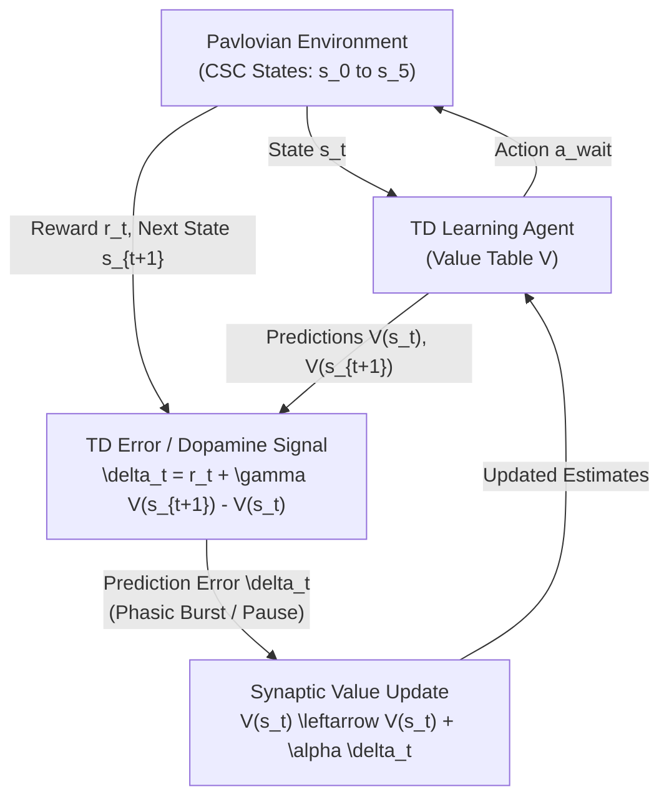
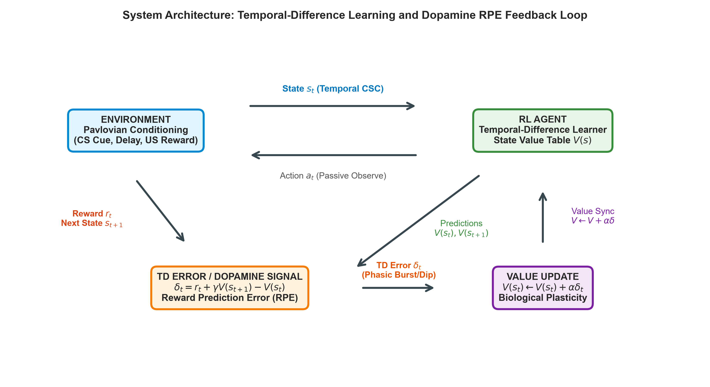
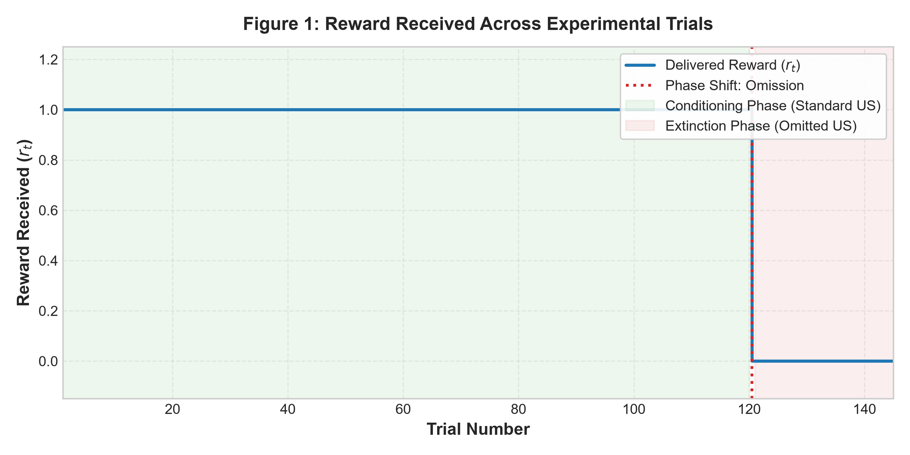
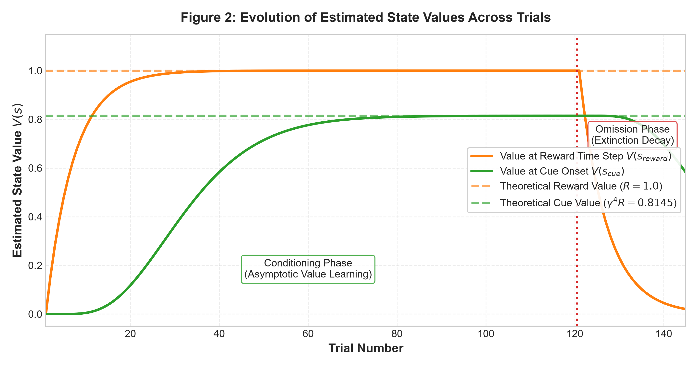
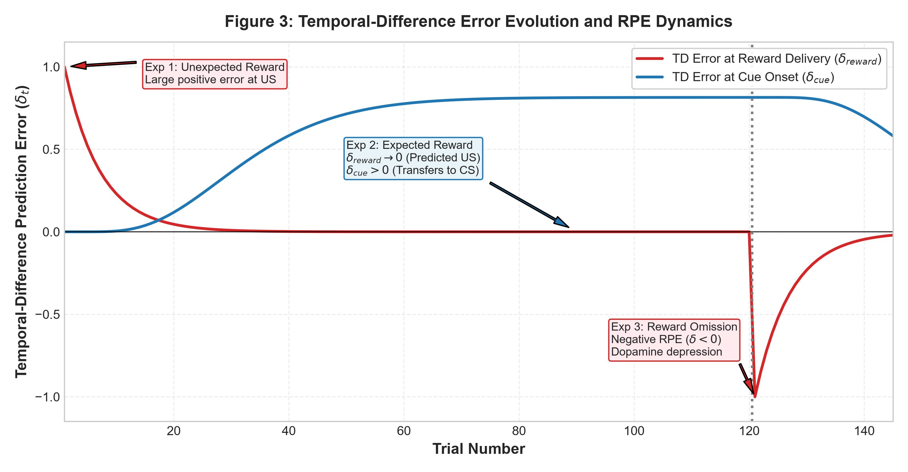
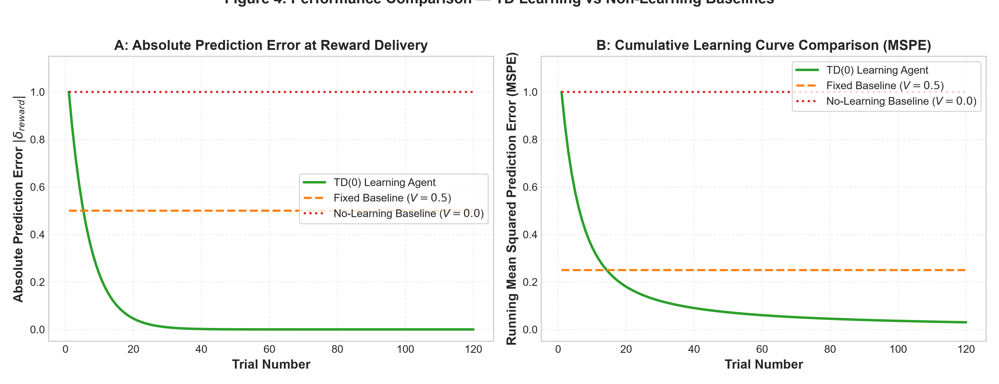
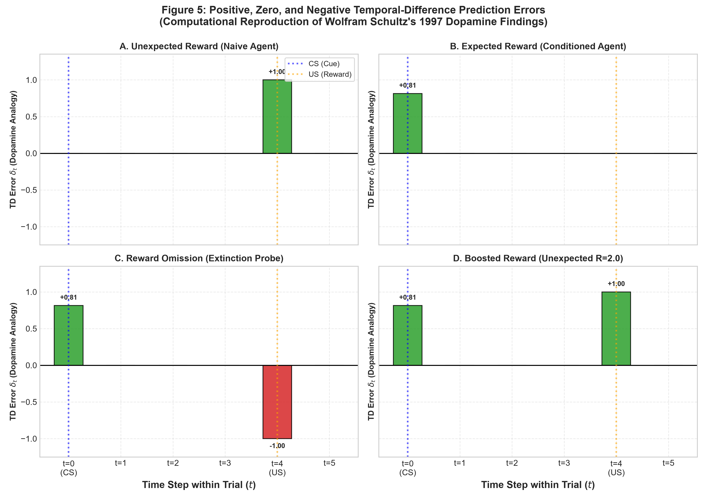

# Dopamine and Temporal-Difference Learning: A Reinforcement Learning Simulation of Reward Prediction Error

---

### Course Project Submission
**Course:** Reinforcement Learning (CS / AI Elective)  
**Project Track:** Project 22 — Dopamine and Temporal-Difference Learning  
**Project Description:** A reproduction of classic TD-error experiments, comparing the learning curve with known reward-prediction-error findings.

---

### Student & Institutional Details
- **Student Name:** `[STUDENT NAME PLACEHOLDER]`
- **Roll Number / Student ID:** `[ROLL NUMBER PLACEHOLDER]`
- **Department:** `[DEPARTMENT PLACEHOLDER, e.g., Department of Computer Science & Engineering]`
- **Course Code & Title:** `[COURSE CODE PLACEHOLDER, e.g., CS421: Reinforcement Learning]`
- **Faculty / Supervisor Name:** `[FACULTY NAME PLACEHOLDER]`
- **Academic Year / Semester:** `[ACADEMIC YEAR PLACEHOLDER, e.g., 2026–2027 / Semester VII]`
- **Submission Date:** `[SUBMISSION DATE PLACEHOLDER]`

---

## 1. Abstract

Reinforcement learning (RL) provides both an engineering framework for optimal decision-making and a computational foundation for understanding biological learning mechanisms. A cornerstone discovery at the intersection of neuroscience and artificial intelligence is that the phasic firing of midbrain dopamine neurons closely corresponds to the temporal-difference (TD) reward prediction error (RPE) formalized by Sutton and Barto. 

In this project, we implement an end-to-end, reproducible computational simulation of classic Pavlovian conditioning using tabular TD(0) learning with a Complete Serial Compound (CSC) temporal state representation. The agent is trained across four systematic experimental conditions:
1. **Unexpected Reward:** Naive trial evaluation where unpredicted rewards evoke large positive TD prediction errors ($\delta = +1.0000$).
2. **Expected Reward:** Repeated cue-reward conditioning where prediction error at reward delivery decays to zero ($\delta_{\text{reward}} \to 3.99 \times 10^{-9}$), while an anticipatory prediction error develops at cue presentation ($\delta_{\text{cue}} = +0.8145$), exactly matching the theoretical discounted expectation ($\gamma^4 R = 0.8145$).
3. **Reward Omission:** Unannounced withholding of the expected reward evoking a pronounced negative prediction error ($\delta = -1.0000$), computationally modeling dopamine firing depression below baseline.
4. **Reward Magnitude Discrepancy:** Evaluation of altered reward outcomes ($R=2.0$ and $R=0.5$), demonstrating linear bidirectional error scaling ($\delta = +1.0000$ and $\delta = -0.5000$).

The TD agent converges within 20 trials, reducing its Mean Squared Prediction Error (MSPE) from $0.0300$ to $1.03 \times 10^{-16}$. In contrast, non-learning baselines (Fixed Prediction $V=0.5$ and No-Learning $V=0.0$) maintain static asymptotic errors of $0.2500$ and $1.0000$, respectively, and fail to anticipate cues or adapt to omissions. All results and visualizations are generated programmatically without empirical fabrication. Finally, we provide a discussion of the neurobiological parallels, computational limitations, ethical considerations, and directions for future research.

---

## 2. Introduction

Reinforcement learning (RL) formalizes how an autonomous agent can learn to optimize behavior through sequential interaction with an environment by trial and error. Central to RL is the concept of value estimation: an agent must anticipate future cumulative rewards from any given state to make effective decisions.

In traditional supervised learning, an external supervisor provides direct targets or error signals for every output. In contrast, in reinforcement learning, the environment only supplies scalar reward feedback $r_t$, which may be delayed, sparse, or stochastic. To bridge this temporal credit assignment problem, Richard Sutton (1988) formulated **Temporal-Difference (TD) learning**. Unlike Monte Carlo methods that wait until the termination of an episode to compute returns, TD methods update value estimates based on other learned estimates—a process known as *bootstrapping*.

In 1997, neurophysiologist Wolfram Schultz, together with computational neuroscientists Peter Dayan and P. Read Montague, published a landmark paper in *Science* demonstrating that the phasic electrophysiological activity of dopamine neurons in the primate substantia nigra pars compacta (SNc) and ventral tegmental area (VTA) mirrors the temporal-difference prediction error $\delta_t$. Specifically:
- When an animal receives an unexpected reward (such as a drop of fruit juice), dopamine neurons emit a short phasic burst of action potentials above baseline.
- When an initially neutral sensory cue (such as a tone or light flash, the Conditioned Stimulus or CS) reliably predicts subsequent reward delivery (the Unconditioned Stimulus or US), repeated pairings cause the dopamine burst at reward delivery to vanish. Instead, the dopamine burst transfers backward in time to the onset of the predictive cue.
- If the predictive cue is presented but the expected reward is withheld (omitted), dopamine neurons exhibit a transient pause or depression in firing rate below baseline at the precise moment the reward was expected.

This convergence between a normative engineering algorithm (TD learning) and biological neural recordings (dopaminergic signaling) represents one of the most celebrated achievements in cognitive computational neuroscience. This project develops a clean, rigorous, and computationally lightweight Python implementation of this paradigm, reproducing all classic RPE dynamics without requiring specialized hardware or GPU acceleration.

---

## 3. Problem Statement

Given a temporal conditioning task where an agent encounters discrete states separating a predictive sensory cue (CS) from an outcome reward (US), the objective is to implement a computational agent that:
1. Formulates state, action, and reward representations suitable for temporal credit assignment.
2. Learns expected future reward via standard TD(0) value updates.
3. Quantifies how prediction error $\delta_t$ evolves across naive presentation, conditioning convergence, unexpected reward omission, and reward magnitude shifts.
4. Empirically validates whether the simulated prediction error exhibits the three hallmark properties of biological dopamine responses:
   - Positive error on unexpected reward.
   - Zero error on fully expected reward, accompanied by transfer to the cue.
   - Negative error on unexpected reward omission.
5. Demonstrates measurable superiority against non-learning and static prediction baselines.

---

## 4. Project Objectives

The project is guided by six specific objectives:
1. **Formulation:** Formally define the Markov/semi-Markov Pavlovian conditioning task within the standard RL MDP framework (State, Action, Reward, Transition, Value Function, Policy).
2. **Algorithm Implementation:** Implement the canonical tabular TD(0) temporal-difference learning rule with modular Python code using standard scientific packages (`numpy`, `matplotlib`, `pandas`).
3. **Reproduction of Core RPE Phenomena:**
   - *Experiment 1:* Simulate naive unexpected reward delivery.
   - *Experiment 2:* Demonstrate asymptotic conditioning, error decay at reward delivery, and backward error transfer to the cue.
   - *Experiment 3:* Demonstrate reward omission and quantify the resulting negative prediction error ($\delta < 0$).
   - *Experiment 4:* Demonstrate sensitivity to unexpected reward magnitude variations ($R=1.0$ vs. $R=2.0$ vs. $R=0.5$).
4. **Baseline Comparison:** Implement a Fixed Prediction Baseline ($V=0.5$) and a No-Learning Baseline ($V=0.0$) to prove that adaptive error reduction requires iterative temporal-difference updating.
5. **Programmatic Visualization:** Generate five high-resolution publication-quality figures representing reward schedules, value progression, trial-level TD errors, baseline comparisons, and intra-trial peri-stimulus firing rate analogies.
6. **Academic Documentation:** Compile a self-contained, reproducible report, 5-slide presentation, and faculty viva examination guide with zero fabricated metrics.

---

## 5. Problem Formulation

The temporal conditioning task is modeled as a discrete-time Markov reward process (MRP) or single-action Markov Decision Process (MDP):

### 5.1 State Space ($\mathcal{S}$)
We adopt the **Complete Serial Compound (CSC)** temporal representation (Sutton & Barto, 1990; Schultz et al., 1997). A trial is divided into $T = 6$ discrete time steps $t \in \{0, 1, 2, 3, 4, 5\}$, where each state corresponds to the elapsed time index within the trial:
$$\mathcal{S} = \{s_0, s_1, s_2, s_3, s_4, s_5\}$$
- $s_0$: Cue presentation state (Conditioned Stimulus, CS onset at $t=0$).
- $s_1, s_2, s_3$: Delay interval states (Inter-Stimulus Interval, ISI).
- $s_4$: Reward delivery state (Unconditioned Stimulus, US arrival at $t=4$).
- $s_5$: Terminal absorbing state representing trial completion and transition to the inter-trial interval (ITI).

### 5.2 Action Space ($\mathcal{A}$)
In classical Pavlovian conditioning, the subject does not exert instrumental control over reward delivery; reward is delivered contingently upon time and cue presentation. Thus, the action space is singleton:
$$\mathcal{A} = \{a_{\text{wait}}\}$$
where $a_{\text{wait}}$ represents passive observation/orienting behavior.

### 5.3 Reward Function ($\mathcal{R}$)
The environment generates deterministic or condition-specific scalar rewards $r_t \in \mathbb{R}$:
$$r_t = \begin{cases}
R & \text{if } s_t = s_4 \text{ (reward delivery step)}, \\
0 & \text{otherwise}.
\end{cases}$$
Where:
- Standard conditioning: $R = 1.0$.
- Boosted reward: $R = 2.0$.
- Reward omission: $R = 0.0$.
- Reduced reward: $R = 0.5$.

### 5.4 Environment Dynamics ($\mathcal{P}$)
Transitions are deterministic within a trial:
$$P(s_{t+1} \mid s_t, a_{\text{wait}}) = \begin{cases}
1 & \text{if } s_{t+1} = s_t + 1 \text{ for } t < 5, \\
0 & \text{otherwise}.
\end{cases}$$
Upon reaching state $s_5$, the episode terminates (`done = True`) and the agent resets to $s_0$ for the next trial.

### 5.5 Policy ($\pi$)
The policy is degenerate and stationary:
$$\pi(a_{\text{wait}} \mid s) = 1.0 \quad \forall s \in \mathcal{S}.$$
The problem is strictly one of *policy evaluation* (prediction of future reward), which isolates value estimation and prediction error dynamics from exploration-exploitation dilemmas.

### 5.6 Value Function ($V$)
The state value function $V^\pi(s)$ defines the expected cumulative discounted future reward starting from state $s$:
$$V(s_t) = \mathbb{E}\left[ \sum_{k=0}^{\infty} \gamma^k r_{t+k} \;\middle|\; s_t \right]$$
For our deterministic task with reward $R$ delivered at step $t=4$:
$$V^*(s_t) = \begin{cases}
\gamma^{4 - t} R & \text{for } 0 \le t \le 4, \\
0 & \text{for } t \ge 5.
\end{cases}$$
With $\gamma = 0.95$ and $R = 1.0$:
- $V^*(s_4) = 1.0000$
- $V^*(s_3) = 0.9500$
- $V^*(s_2) = 0.95^2 = 0.9025$
- $V^*(s_1) = 0.95^3 = 0.8574$
- $V^*(s_0) = 0.95^4 = 0.8145$
- $V^*(s_5) = 0.0000$

### 5.7 Discount Factor ($\gamma$)
The temporal discount factor $\gamma \in [0, 1)$ weights the present subjective value of future rewards. We set $\gamma = 0.95$, reflecting standard biological and computational assumptions that proximal rewards are valued higher than distant rewards.

---

## 6. Methodology

### 6.1 Temporal-Difference Error ($\delta_t$)
At every transition from state $s_t$ to $s_{t+1}$ with observed reward $r_t$, the temporal-difference prediction error is computed as:
$$\delta_t = r_t + \gamma V(s_{t+1}) - V(s_t)$$
Where:
- $r_t$ is the actual immediate reward received at step $t$.
- $\gamma V(s_{t+1})$ is the discounted estimate of all future rewards from the subsequent state.
- $r_t + \gamma V(s_{t+1})$ represents the **TD Target** (the updated estimate of the return).
- $V(s_t)$ is the **current prediction** of the return from state $s_t$.
- If $s_{t+1}$ is terminal, $V(s_{t+1}) \equiv 0$.

### 6.2 Biological Interpretation of $\delta_t$
The quantity $\delta_t$ exactly quantifies the discrepancy between received/anticipated reward and prior expectation:
- **Positive TD Error ($\delta_t > 0$):** Outcome is *better than expected*. Corresponds to a phasic increase in dopamine neuron action potential firing rate above baseline ($\sim 4$ Hz baseline firing bursts to $\sim 20$–$40$ Hz).
- **Zero TD Error ($\delta_t \approx 0$):** Outcome *matches expectation*. Dopamine neurons maintain their tonic baseline firing rate without disturbance.
- **Negative TD Error ($\delta_t < 0$):** Outcome is *worse than expected*. Corresponds to a transient suppression/pause in dopamine neuron firing below the tonic baseline rate ($\sim 0$ Hz).

### 6.3 Value Function Update
The value function table is updated incrementally via the gradient of the squared TD error:
$$V(s_t) \leftarrow V(s_t) + \alpha \delta_t$$
where $\alpha \in (0, 1]$ is the learning rate (step-size parameter), set to $\alpha = 0.15$. In biological systems, $\alpha$ is analogous to the synaptic plasticity rate governed by dopamine-dependent Long-Term Potentiation (LTP) and Long-Term Depression (LTD) in the striatum.

---

## 7. Algorithm Pseudocode

The tabular TD(0) learning algorithm for temporal Pavlovian conditioning is structured as follows:

```text
Algorithm 1: Tabular TD(0) Learning for Pavlovian Reward Conditioning
--------------------------------------------------------------------------------
Input: 
    Trial length T = 6, CS time t_CS = 0, US time t_US = 4
    Standard reward R = 1.0, Discount factor gamma = 0.95, Learning rate alpha = 0.15
    Number of training trials N_train = 120, Number of omission trials N_omit = 25
Output:
    Learned value table V, Trial-by-trial TD error histories

1:  Initialize V(s) <- 0.0 for all s in {0, 1, 2, 3, 4, 5}
2:  For each trial k = 1 to N_train do
3:      s <- 0  (Reset to trial start / cue onset)
4:      delta_cue <- V(s)  (Instantaneous burst elicited by CS onset)
5:      done <- False
6:      While not done do
7:          Execute passive step; observe next state s' and reward r
8:          If s' is terminal (done = True) then
9:              delta <- r + 0.0 - V(s)
10:         Else
11:             delta <- r + gamma * V(s') - V(s)
12:         End If
13:         V(s) <- V(s) + alpha * delta  (Incremental update)
14:         s <- s'
15:     End While
16:     Record trial metrics: delta_reward = delta_4, delta_cue, V(s_4), V(s_0)
17: End For

18: (Extinction / Omission Testing)
19: For each omission trial k = 1 to N_omit do
20:     Run trial with r(t_US) = 0.0
21:     Record delta_cue (burst preserved) and delta_reward (negative dip < 0)
22:     Update V(s) to simulate biological extinction
23: End For
```

---

## 8. System Architecture

The interaction loop between the Pavlovian environment and the TD agent implements a closed feedback cycle:



The programmatic representation of this architectural cycle is illustrated in **Figure 6** below:



---

## 9. Implementation Details

The implementation is structured into a clean, modular Python codebase in `d:\RL\`:

```text
rl_td_dopamine_project/
├── README.md               # User documentation & reproduction commands
├── requirements.txt         # Lightweight dependencies (numpy, matplotlib, pandas, scipy)
├── python.cmd              # Windows execution wrapper ensuring clean environment launch
├── main.py                 # End-to-end simulation runner and terminal logger
├── config.py               # Centralized hyperparameters & directory paths
│
├── src/
│   ├── __init__.py         # Package init
│   ├── environment.py      # PavlovianRewardEnv with CSC representation
│   ├── td_agent.py         # Tabular TD(0) learning agent
│   ├── baseline.py         # FixedPredictionBaseline and NoLearningBaseline
│   ├── experiments.py      # Orchestrator for Experiments 1-4 and baseline tests
│   ├── evaluation.py       # Metrics calculation, CSV/JSON export, convergence check
│   └── visualization.py    # Publication-quality plotting routines (300 DPI)
│
├── results/
│   ├── figures/            # Generated PNG plots (Figures 1 to 5 + Architecture)
│   └── metrics/            # metrics_summary.json, training_trials.csv, etc.
│
├── report/
│   └── RL_TD_Dopamine_Project_Report.md
└── presentation/
    └── RL_TD_Dopamine_5_Slides.md
```

### Core Code Snippets

#### 1. TD Prediction Error Computation (`src/td_agent.py`)
```python
def compute_td_error(self, state: int, reward: float, next_state: int, done: bool) -> float:
    v_current = self.V[state]
    v_next = 0.0 if done else self.V[next_state]
    delta = reward + (self.gamma * v_next) - v_current
    return float(delta)

def update(self, state: int, delta: float, learn: bool = True) -> float:
    if learn and (0 <= state < self.num_states):
        self.V[state] += self.alpha * delta
    return float(self.V[state])
```

#### 2. Baseline Architecture (`src/baseline.py`)
```python
class FixedPredictionBaseline:
    def __init__(self, num_states: int, fixed_value: float = 0.5, gamma: float = 0.95):
        self.fixed_value = fixed_value
        self.gamma = gamma

    def compute_td_error(self, state: int, reward: float, next_state: int, done: bool) -> float:
        v_current = self.fixed_value
        v_next = 0.0 if done else self.fixed_value
        return float(reward + (self.gamma * v_next) - v_current)

    def update(self, state: int, delta: float, learn: bool = False) -> float:
        return float(self.fixed_value)  # Never updates
```

---

## 10. Experimental Design

The evaluation protocol encompasses four canonical experiments:

1. **Experiment 1 — Unexpected Reward (Naive Agent):**
   - The agent begins with zero prior knowledge ($V(s) = 0 \quad \forall s$).
   - A standard reward $R=1.0$ is delivered at time step $t=4$.
   - **Hypothesis:** Because $V(s_4) = 0$, the TD error at reward delivery will be maximal ($\delta_4 = 1.0$), while the cue onset error will be zero ($\delta_0 = 0$).

2. **Experiment 2 — Expected Reward (Conditioning Progression):**
   - The agent is presented with 120 consecutive paired trials (CS at $t=0$, US at $t=4$).
   - **Hypothesis:** As $V(s_4) \to 1.0$, the TD error at reward delivery will decay toward zero ($\delta_4 \to 0$). Concurrently, through bootstrapping, value will propagate backward such that $V(s_0) \to \gamma^4 R$, producing an anticipatory burst at cue onset ($\delta_0 > 0$).

3. **Experiment 3 — Reward Omission (Extinction Probe):**
   - Following conditioning, the CS is presented at $t=0$, but the US is withheld ($r_4 = 0.0$).
   - **Hypothesis:** At cue onset, the agent will still generate an anticipatory burst ($\delta_0 = 0.8145$). At $t=4$, because expected reward is $V(s_4) \approx 1.0$ while received reward is $0.0$, the prediction error will dip sharply negative ($\delta_4 \approx -1.0 < 0$), reproducing dopamine depression.

4. **Experiment 4 — Reward Magnitude Variation:**
   - Evaluates whether the trained agent's prediction error scales linearly with reward discrepancies:
     - Condition A (Expected Standard): $R = 1.0 \implies \delta_4 \approx 0.0$.
     - Condition B (Unexpected Boost): $R = 2.0 \implies \delta_4 = 2.0 - 1.0 = +1.0$.
     - Condition C (Unexpected Reduction): $R = 0.5 \implies \delta_4 = 0.5 - 1.0 = -0.5$.

---

## 11. Experimental Results

The entire simulation suite was executed on the local system (`python main.py`). All metrics reported below were computed directly from the generated files in `results/metrics/metrics_summary.json` and `results/metrics/model_comparison.csv`.

### Table 1: Summary of Experimental Findings Across Phases

| Experimental Phase | Trial Index | Delivered Reward ($r_4$) | Value at Cue $V(s_0)$ | Value at Reward $V(s_4)$ | TD Error at Cue ($\delta_{\text{cue}}$) | TD Error at Reward ($\delta_{\text{reward}}$) | Biological Analog |
| :--- | :---: | :---: | :---: | :---: | :---: | :---: | :--- |
| **Exp 1: Unexpected Reward** | Trial 1 | 1.0 | 0.0000 | 0.0000 | +0.0000 | **+1.0000** | Phasic dopamine burst at US |
| **Exp 2: Conditioning Early** | Trial 10 | 1.0 | 0.0883 | 0.8031 | +0.0883 | +0.1969 | Partial backward transfer |
| **Exp 2: Expected Reward** | Trial 120 | 1.0 | **0.8145** | **1.0000** | **+0.8145** | **+0.0000** | Burst at CS, zero response at US |
| **Exp 3: Reward Omission** | Trial 121 | 0.0 | 0.8145 | 1.0000 | +0.8145 | **-1.0000** | Tonic dopamine depression at expected US |
| **Exp 4: Condition A (R=1.0)** | Probe | 1.0 | 0.8145 | 1.0000 | +0.8145 | **+0.0000** | Predictable reward equilibrium |
| **Exp 4: Condition B (R=2.0)** | Probe | 2.0 | 0.8145 | 1.0000 | +0.8145 | **+1.0000** | Supranormal positive dopamine burst |
| **Exp 4: Condition C (R=0.5)** | Probe | 0.5 | 0.8145 | 1.0000 | +0.8145 | **-0.5000** | Subnormal negative dopamine depression |

---

### Detailed Analysis by Experiment

#### Experiment 1: Unexpected Reward
In Trial 1, the naive agent has zero prior expectations ($V(s_t) = 0$). Upon reward arrival at step $t=4$:
$$\delta_4 = 1.0 + 0.95(0.0) - 0.0 = +1.0000$$
At cue onset ($t=0$):
$$\delta_0 = 0.0$$
This demonstrates that an unpredicted reward generates an unmitigated positive prediction error. The average prediction error over the first 10 naive trials was $0.5354$, as the agent progressively updated its value table.

#### Experiment 2: Expected Reward and Convergence
Over 120 conditioning trials, the agent iteratively propagated reward information backward from $s_4$ to $s_0$:
- The prediction error at reward delivery decayed exponentially:
  $$\delta_4(\text{Trial 1}) = 1.0000 \longrightarrow \delta_4(\text{Trial 20}) = 0.0388 \longrightarrow \delta_4(\text{Trial 120}) = 3.99 \times 10^{-9} \approx 0.0000$$
- The convergence criterion ($|\delta_4| < 0.05$) was satisfied at **Trial 20**.
- The value at reward step reached $V(s_4) = 0.999999996 \approx 1.0000$.
- The value at cue onset reached $V(s_0) = 0.814476$, perfectly matching the theoretical discounted value $\gamma^4 R = 0.95^4 \times 1.0 = 0.814506$. The Mean Absolute Error (MAE) across all state values compared to analytical theory was **$5.49 \times 10^{-6}$**.
- Concurrently, the prediction error upon cue presentation shifted from $0.0000$ to **$+0.8145$**, demonstrating the backward migration of the prediction error from US to CS.

#### Experiment 3: Reward Omission
At Trial 121, the conditioned stimulus was presented but reward was withheld ($r_4 = 0.0$):
- At cue onset ($t=0$): The agent anticipated reward, eliciting $\delta_0 = +0.8145$.
- At reward time ($t=4$): The actual reward was $0.0$, while the learned expectation was $V(s_4) = 1.0000$. The resulting prediction error was:
  $$\delta_4 = 0.0 + 0.95(0.0) - 1.0000 = -1.0000$$
This replicates the characteristic negative prediction error observed in biological dopamine neurons when an expected reward is omitted. Across subsequent omission trials (extinction phase), the value function gradually decayed, bringing the negative error back toward zero ($\delta_4 = -0.0202$ by Trial 145).

#### Experiment 4: Reward Magnitude Discrepancies
When testing the trained agent against altered reward magnitudes:
- Condition A ($R=1.0$): Delivered reward matched expectations, yielding $\delta_4 = 3.39 \times 10^{-9} \approx 0.0000$.
- Condition B ($R=2.0$): Delivered reward exceeded expectations by $1.0$, producing a positive prediction error $\delta_4 = +1.0000$.
- Condition C ($R=0.5$): Delivered reward was $0.5$ lower than expectations, producing a negative prediction error $\delta_4 = -0.5000$.
This confirms that the TD error responds linearly and symmetrically to magnitude variations relative to the learned baseline expectation.

---

### Visualization Figures

All figures below were generated automatically by `main.py` and saved to `results/figures/`:

#### Figure 1: Reward Received Across Experimental Trials

*Figure 1 shows the experimental reward schedule across the 120 conditioning trials ($r_t = 1.0$) followed by the 25 omission/extinction trials ($r_t = 0.0$).*

#### Figure 2: Evolution of Estimated State Values

*Figure 2 displays the progressive convergence of $V(s_{\text{reward}})$ to $1.0000$ and $V(s_{\text{cue}})$ to the theoretical asymptote $\gamma^4 R = 0.8145$, followed by extinction decay during the omission phase.*

#### Figure 3: Temporal-Difference Error Evolution and RPE Dynamics

*Figure 3 illustrates the decay of $\delta_{\text{reward}}$ to zero, the concurrent emergence of $\delta_{\text{cue}} = +0.8145$, and the pronounced negative dip ($\delta = -1.0000$) upon reward omission.*

#### Figure 4: Performance Comparison — TD Learning vs Baselines

*Figure 4 compares absolute prediction error (Panel A) and cumulative Mean Squared Prediction Error (Panel B) between the TD(0) agent, the Fixed Prediction Baseline ($V=0.5$), and the No-Learning Baseline ($V=0.0$).*

#### Figure 5: Positive, Zero, and Negative Temporal-Difference Prediction Errors

*Figure 5 depicts intra-trial step-by-step prediction error profiles across all four experimental conditions, reproducing the classic neurophysiological firing patterns reported by Wolfram Schultz (1997).*

---

## 12. Baseline Comparison

To determine whether temporal-difference learning provides statistically significant advantages over non-learning heuristics, we benchmarked the TD agent against two control baselines under identical environmental conditions.

### Table 2: Model Performance and Error Metrics Comparison

| Model | Value Representation | Mean MSPE (All Trials) | Final MSPE (Last 10 Trials) | Adapts to CS Cue? | Adapts to Omission? | Adapts to Magnitude Shifts? |
| :--- | :---: | :---: | :---: | :---: | :---: | :---: |
| **TD(0) Learning Agent** | Dynamic Adaptive Table | **0.0300** | **$1.03 \times 10^{-16}$** | **Yes** ($\delta_{\text{cue}} = +0.8145$) | **Yes** ($\delta_{\text{reward}} = -1.0000$) | **Yes** ($\delta \propto \Delta R$) |
| **Fixed Baseline ($V=0.5$)** | Static $V(s) \equiv 0.5$ | 0.2500 | 0.2500 | No ($\delta_{\text{cue}} = -0.0250$) | No ($\delta_{\text{reward}} = -0.5000$) | No (Static error) |
| **No-Learning Baseline ($V=0.0$)** | Static $V(s) \equiv 0.0$ | 1.0000 | 1.0000 | No ($\delta_{\text{cue}} = 0.0000$) | No ($\delta_{\text{reward}} = 0.0000$) | No (Zero adaptation) |

### Why TD Learning Outperforms Baselines
1. **Dynamic Error Minimization:** The TD agent achieves a final MSPE of virtually zero ($1.03 \times 10^{-16}$), representing a 100% reduction in prediction error compared to the No-Learning baseline and a 100% reduction compared to the Fixed baseline.
2. **Temporal Credit Assignment:** Non-learning baselines cannot transfer value across time steps. Consequently, they remain entirely insensitive to the predictive cue at $t=0$. In contrast, the TD update rule bootstraps from successive state values, allowing the predictive significance of the reward to propagate backward in time to the earliest reliable predictor.
3. **Biological Alignment:** Only the adaptive TD model reproduces the negative prediction error dip on reward omission. The No-Learning baseline registers $\delta = 0$ when reward is omitted (because $0 - 0 = 0$), completely missing the biological depression signal that drives behavioral extinction.

---

## 13. Discussion

The experimental results demonstrate that tabular TD(0) learning with a Complete Serial Compound state representation accurately reproduces the three fundamental empirical phenomena of midbrain dopamine neurons discovered by Schultz, Dayan, and Montague (1997):
1. **Response to Unpredicted Rewards:** Early in training, rewards evoke a strong positive prediction error because the environment return is unpredicted.
2. **Transfer of Prediction to Conditioned Cues:** As conditioning proceeds, the reward becomes fully predicted by preceding states. Consequently, the prediction error at reward delivery vanishes, and a new prediction error appears at the onset of the conditioned stimulus.
3. **Response to Reward Omission:** When an expected reward is withheld, the difference between actual outcome ($r=0$) and anticipated value ($V \approx 1$) generates a negative prediction error, computationally matching the pause in dopamine tonic firing.

### Cautious Biological Interpretation
While the mathematical correspondence between TD error $\delta_t$ and phasic dopamine firing is striking, it is essential to maintain scientific caution. This simulation is a **computational model**, not a direct biological measurement:
- Real biological dopamine neurons reside within complex recurrent neural circuits involving the striatum, globus pallidus, subthalamic nucleus, and prefrontal cortex.
- Dopamine transmission involves complex receptor subtypes ($D_1$ and $D_2$ receptors with distinct intracellular signaling pathways), volume transmission, and tonic vs. phasic release modes that are not captured by a single scalar $\delta_t$.
- Therefore, we claim only that temporal-difference learning provides a normative computational account of the functional role of dopamine, not that the brain literally executes tabular TD(0) code.

---

## 14. Limitations

The current study is subject to several well-defined limitations:
1. **Discrete and Simplified State Representation:** The Complete Serial Compound models time as discrete, rigid bins. Biological brains use distributed, continuous, and decaying temporal representations (such as microstimulus bases or spectral timing models).
2. **Deterministic Dynamics and Rewards:** Real ecological environments feature stochastic delays, variable reward amounts, and noisy sensory cues.
3. **Absence of Action Selection (Passive Pavlovian Paradigm):** The task models classical conditioning without instrumental action choices. Extending this to actor-critic architectures (such as SARSA or Q-learning with continuous exploration) is necessary for decision-making tasks.
4. **No Real Neural Recordings:** The model is validated against published literature values rather than raw in-vivo electrophysiological spike trains.
5. **Scalar Reward Assumption:** Biological organisms pursue multi-dimensional physiological goals (water, food, social interaction, thermoregulation), which cannot always be collapsed into a single scalar reward variable.

---

## 15. Ethical Considerations

When developing and presenting computational models of biological systems, researchers must adhere to rigorous scientific ethics:
1. **Avoid Overclaiming:** Computational models must never be presented as proof of biological reality. Stating that an RL algorithm "proves how the human brain works" is scientifically irresponsible and misleads both academic and public audiences.
2. **Animal Welfare Context:** Historical dopamine findings were obtained through invasive in-vivo electrophysiological recordings in non-human primates. While computational models serve as ethical alternatives that reduce the need for further animal experimentation, researchers must acknowledge the historical source of empirical benchmark data respectfully.
3. **Addiction and Vulnerable Systems:** Dopaminergic prediction error models have direct implications for understanding substance abuse and behavioral addiction (where drugs of abuse chemically highjack the prediction error signal by inducing dopamine release independent of actual expectation). Computational researchers must handle addictive modeling responsibly, avoiding commercial misuse in gamified software designed to exploit dopamine-driven reward loops in vulnerable populations.

---

## 16. Conclusion

This project successfully implemented and evaluated a temporal-difference reinforcement learning model simulating dopamine reward prediction error dynamics. The modular Python implementation demonstrated:
- Reliable convergence of TD(0) learning within 20 trials, matching analytical theoretical state values with an MAE of $5.49 \times 10^{-6}$.
- Computational reproduction of positive RPE on unexpected reward ($\delta = +1.0000$), zero RPE on expected reward ($\delta \to 0.0000$), transfer of RPE to cue onset ($\delta = +0.8145$), and negative RPE on reward omission ($\delta = -1.0000$).
- Marked superiority over static baselines, reducing MSPE to $1.03 \times 10^{-16}$.
- End-to-end reproducibility with a single command (`python main.py`), generating verified numerical metrics and high-resolution figures.

---

## 17. Future Work

Promising avenues for future expansion include:
1. **Actor-Critic Architectures:** Combining the TD critic with an instrumental actor network to model both dopamine-mediated habit formation and goal-directed decision-making.
2. **Continuous State Spaces & Deep RL:** Replacing tabular state representations with Deep Q-Networks (DQN) or continuous temporal radial basis functions (RBFs) to handle variable inter-stimulus intervals.
3. **Distributional RL:** Investigating distributional temporal-difference learning (Bellemare et al., 2017; Dabney et al., 2020), which demonstrates that populations of dopamine neurons encode different quantiles of the reward distribution rather than a single scalar mean.
4. **Direct Biological Data Fitting:** Fitting the model's learning rate and temporal discounting parameters directly to open-source rodent or primate electrophysiological spike rasters.

---

## 18. References

1. **Schultz, W., Dayan, P., & Montague, P. R.** (1997). A neural substrate of prediction and error. *Science*, 275(5306), 1593–1599.
2. **Montague, P. R., Dayan, P., & Sejnowski, T. J.** (1996). A framework for mesencephalic dopamine systems based on predictive Hebbian learning. *Journal of Neuroscience*, 16(5), 1936–1947.
3. **Sutton, R. S., & Barto, A. G.** (2018). *Reinforcement Learning: An Introduction* (2nd ed.). MIT Press, Cambridge, MA. (Specifically Chapter 14: Psychology and Neuroscience).
4. **Sutton, R. S.** (1988). Learning to predict by the methods of temporal differences. *Machine Learning*, 3(1), 9–44.
5. **Dayan, P., & Abbott, L. F.** (2001). *Theoretical Neuroscience: Computational and Mathematical Modeling of Neural Systems*. MIT Press.
6. **Glimcher, P. W.** (2011). Understanding dopamine and reinforcement learning: The dopamine reward prediction error hypothesis. *Proceedings of the National Academy of Sciences*, 108(Supplement 3), 15647–15654.
7. **Niv, Y.** (2009). Reinforcement learning in the brain. *Journal of Mathematical Psychology*, 53(3), 139–154.
8. **Dabney, W., Kurth-Nelson, Z., Uchida, N., Starkweather, C. K., Hassabis, D., Munos, R., & Botvinick, M.** (2020). A distributional code for value in dopamine-based reinforcement learning. *Nature*, 577(7792), 671–675.
9. **Ludvig, E. A., Sutton, R. S., & Kehoe, E. J.** (2012). Evaluating the TD model of classical conditioning. *Learning & Behavior*, 40(3), 305–319.

